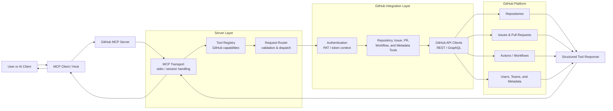

# Architecture Overview

## Overview

This architecture follows a simple request-response flow:

- An AI client or user sends a request through the MCP interface.
- The GitHub MCP server receives the request and routes it through the tool registry.
- Authenticated GitHub API calls are executed to access repositories, issues, pull requests, workflows, and related metadata.
- Results are transformed into structured responses and returned to the client.

The design keeps the protocol layer separate from the GitHub integration layer, making it easier to extend capabilities without changing the overall client experience.
